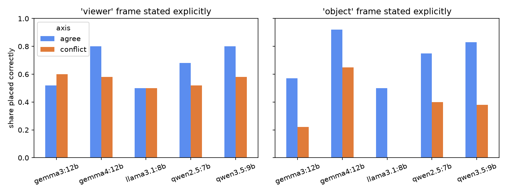

# Whose left? Frame-of-reference choices when LLMs place objects in a 3D scene

"Put the lamp to the left of the sofa." Left from the **viewer's** point of view, or the **sofa's own** left?
The two readings disagree whenever the sofa faces the viewer. This small study measures which reading
local open LLMs choose when they *generate* a 3D layout, whether they follow an explicitly stated frame,
and whether they ask for clarification when (and only when) the instruction is genuinely ambiguous.

Prior frame-of-reference work (e.g., What'sUp, COMFORT) studies *perception* of existing images; text-to-3D
layout systems (LayoutGPT, Holodeck) check constraints under one fixed reading. This project looks at the
*generation* side.

## Research questions
1. **Default frame:** with no frame stated, which frame do models use?
2. **Instruction following:** with "from the camera's view" / "from the sofa's own perspective", do they comply, and does accuracy drop when the frames conflict?
3. **Human comparison:** do model defaults match what people expect? (survey materials in `survey/`)
4. **Calibrated clarification:** when allowed to ask, do models ask "your left or the sofa's left?" only when the frames actually disagree?

## Design
- Top-down world: camera at (0, -10) looking toward +y; anchor at the origin facing **away**, **toward**, or **sideways**.
- 5 anchors × 4 relations (left/right/front/behind) × 3 facings × frame conditions (ambiguous / viewer / object / ask) × 3 paraphrases.
- A geometric checker labels every placement as viewer-consistent, object-consistent, both, or neither.
- Models (local, via Ollama): Llama 3.1 8B, Qwen 2.5 7B, Gemma 3 12B, Qwen 3.5 9B, Gemma 4 12B.
- `viewer/index.html`: a three.js / WebXR viewer that renders the generated scenes (VR headset optional).

## Run
```
python -I for_pipeline.py selftest   # checker unit tests, no model needed
python -I for_pipeline.py pilot      # 12 prompts on one model
python -I for_pipeline.py run        # all prompts, all models (resumable)
python -I for_pipeline.py results    # tables -> results/RESULTS.md
python -I make_survey.py             # survey images + answer key
```
`watchdog.py` stops a run if the GPU gets too hot (used for unattended overnight runs).

## Results (3,600 placements, 5 models, 0 invalid outputs)
Full tables: [`results/RESULTS.md`](results/RESULTS.md). Problems we hit and how we handled them: [`docs/RESEARCH_LOG.md`](docs/RESEARCH_LOG.md).

- **No model asks "whose left?".** When explicitly allowed to ask a clarifying question, models asked in only 21 of 900 prompts, and **none of the 21 questions was about the frame of reference**. Gemma 3 asked about distance ("How far left?") at the same rate whether or not the frames disagreed. Gemma 4 and Qwen 3.5, the newest models, never asked.
- **Default frame (RQ1):** when the instruction is ambiguous and the two readings disagree, models choose the viewer's frame about 50 to 63% of the time and the object's frame 27 to 50% of the time. No model is consistent, so a user cannot predict which "left" they will get.
- **Stating the frame does not fully fix it (RQ2):** when told to use the object's own left, accuracy drops sharply once that conflicts with the viewer's left. Gemma 4 goes from 0.92 to 0.65, Qwen 3.5 from 0.83 to 0.38, and Gemma 3 from 0.57 to 0.22. The viewer frame holds up better. Newer models are better overall, but none is reliable when the frames conflict.
- **Consistency can be misleading.** Llama 3.1 8B has the highest paraphrase consistency (0.96), but mostly because it often outputs the same coordinate whatever the relation is; it never placed an object correctly in the object frame when frames conflicted.



**Why it matters for AR/VR and robots:** an assistant that places virtual objects or moves a robot on spoken instructions will silently pick one reading of "left". These results suggest that, for now, a system should resolve the frame itself (for example from the user's gaze or position) or ask, instead of trusting the model to ask.

Limitations: a top-down 2D abstraction of a 3D room, one temperature-0 sample per prompt, and five small local models. The human survey (RQ3) is prepared in `survey/` but not yet run.

## Disclosure
Code and documentation were written with the help of an AI assistant; the research design, checking and
decisions are the author's.

## License
MIT
